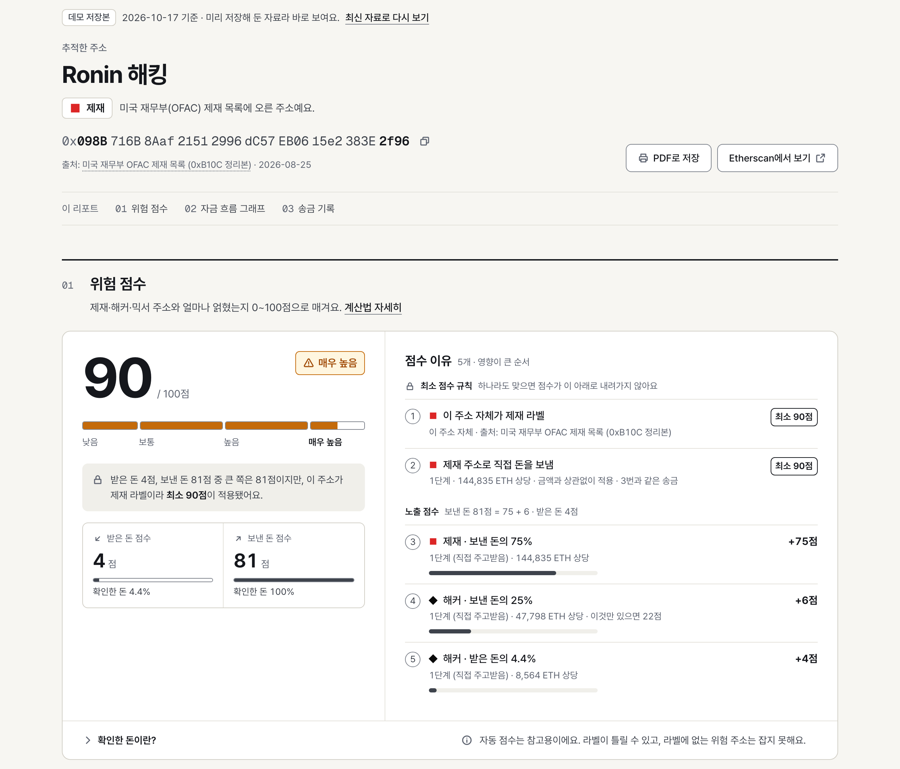
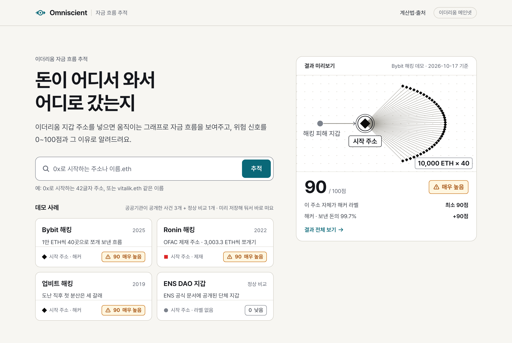
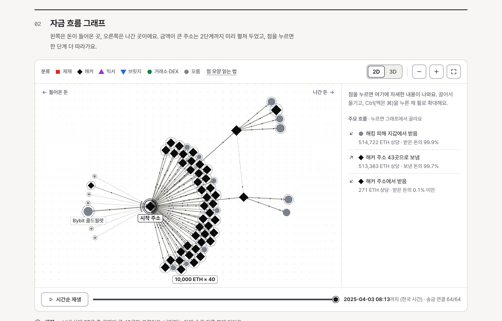

# Omniscient

**이더리움 지갑 주소의 자금 흐름을 그래프로 그리고, 위험 신호를 0~100점과 그 이유로 보여주는 웹앱**

Chainalysis·Arkham 같은 블록체인 분석 도구의 핵심 아이디어를 작게 구현한 비상업 포트폴리오 프로젝트예요.
공공기관이 공개한 해킹 사건(Bybit 2025, Ronin 2022, 업비트 2019)을 데모로 바로 볼 수 있어요.

**사이트** · https://omniscient-orcin.vercel.app

> An Ethereum fund-flow tracer: enter an address to see an animated money-flow graph and a 0–100 exposure score with
> the reasons behind it. Built with Next.js 16, React 19, viem and react-force-graph. Korean UI.



## 주요 기능

| 기능 | 설명 |
|---|---|
| 자금 흐름 그래프 | 받은 돈은 왼쪽, 보낸 돈은 오른쪽. 금액이 큰 곳은 2단계까지 미리 펼치고, 점을 누르면 한 단계씩 더 따라가요. 비슷한 금액으로 쪼개 보낸 돈은 꽃잎 묶음으로 보여줘요 |
| 주소 라벨 | 제재(빨강 네모)·해커(검정 마름모)·믹서(보라 세모)·브릿지(파랑 거꾸로 세모)·거래소·DEX(초록 육각형). 라벨마다 공개 자료의 출처와 날짜를 보여줘요 |
| 위험 점수 | 받은 돈과 보낸 돈을 따로 계산한 0~100점, 점수가 나온 계산 한 줄, 영향이 큰 순서의 이유 목록. 라벨로 확인한 돈의 비율도 같이 보여줘요 |
| 주요 흐름·주요 거래 | 그래프 옆에 라벨 있는 상대와 오간 돈을 글로 요약하고, 송금 기록 표는 라벨 있는 거래와 큰 거래부터 금액순으로 보여줘요 |
| 시간 재생 | 슬라이더를 옮기거나 재생 버튼을 누르면 돈이 오간 순서대로 그래프가 자라요 |
| 3D 보기 | 같은 그래프를 입체로 돌려 봐요. 버튼을 누를 때만 내려받아서 첫 화면은 가벼워요 |
| PDF 리포트 | 머리말·점수·그래프·송금 기록을 A4 문서로 저장해요 |
| 접근성 | 분류마다 색과 모양이 달라서 색을 구분하기 어려워도 알아볼 수 있어요. 키보드만으로 그래프 점을 골라 펼칠 수 있고, 고대비 모드와 '동작 줄이기' 설정을 따라요 |

| 첫 화면 | Bybit 해킹 자금 흐름 |
|---|---|
|  |  |

## 동작 방식

```text
주소 또는 이름.eth 입력
  → 서버가 Alchemy로 받은 기록·보낸 기록을 따로 조회 (주소마다 최신 1,000건씩)
  → 상대 주소별로 합치고 ETH 값으로 환산 (컨트랙트 주소로 확인한 토큰만)
  → data/labels.json(공개 자료로 만든 라벨)과 대조
  → 그래프: 기본 2단계 · 한쪽 상위 10곳 · 0.01 ETH 미만 먼지 제외 · 거래소·DEX·브릿지·믹서에서 멈춤
  → 점수: (받은/보낸, 분류, 단계) 묶음마다 기여도를 계산해서 합침
  → 화면: 점수 카드 + 그래프 + 송금 기록 표 (따로 스트리밍해서 먼저 준비된 것부터 보임)
```

- API 키는 서버에만 있어요 (Next.js 서버 컴포넌트·Route Handler, `server-only`). 외부 호출은 동시 2개, 429면 지수 백오프, 결과는 캐시
- 데모 4개는 `data/demos/*.json` 저장본으로 보여줘서 외부 API를 호출하지 않아요 (주소 뒤에 `?live=1`을 붙이면 실시간)
- 가짜 토큰(이름만 USDT 등)은 컨트랙트 주소 화이트리스트로 요청 단계에서 걸러요. 금액은 BigInt와 토큰별 소수 자릿수로 계산해요

## 위험 점수

- **기여도 = 얼마나 나쁜 곳인지 × 몇 단계 건너인지 × 돈의 몇 %인지**
  - 무게: 제재 1.0 · 해커 0.9 · 믹서 0.7 · 브릿지 0.1 · 거래소·DEX 0
  - 거리: 직접 1.0 · 한 곳 거쳐서 0.5 (금액 비중은 단계마다 곱함)
- **위험 = 1 − (1 − 기여도₁) × (1 − 기여도₂) × …** → 100을 곱해 반올림, 100점을 넘지 않음
- **최소 점수 규칙**: 주소 자체가 제재·해커 라벨이거나 제재 주소로 직접 보냈으면 최소 90점
- 받은 먼지(0.01 ETH 미만)는 무시하고, 해킹 피해 지갑은 해커에게 보낸 돈을 빼고 계산해요
- 같은 돈을 지갑 여러 개로 쪼개도 점수가 같도록, 지갑마다가 아니라 묶음마다 금액을 먼저 더해요
- 업계에서 공개한 개념(직접·간접 노출, 단계, 금액 비중, 4단계 등급)을 참고한 단순화 모델이에요. 실제 업계 도구의 계산식은 공개돼 있지 않아요

계산 예시와 전체 규칙은 사이트의 [자료 출처·계산법](https://omniscient-orcin.vercel.app/sources)에 있어요. 점수 계산은
순수 함수(`lib/risk.ts`)로 분리해서 데모 사례의 실제 자료로 단위 테스트해요.

## 자료 출처

| 자료 | 쓰는 곳 | 라이선스·조건 |
|---|---|---|
| [Alchemy Transfers API](https://www.alchemy.com/docs/data/transfers-api/transfers-endpoints/alchemy-get-asset-transfers) | 송금 기록 (이더리움 메인넷) | 무료 API 키 |
| [OFAC 제재 목록 (0xB10C 정리본)](https://github.com/0xB10C/ofac-sanctioned-digital-currency-addresses) | 제재 | MIT, 데이터는 미국 정부 공개자료 |
| [FBI 공지 PSA250226](https://www.ic3.gov/PSA/2025/PSA250226) | 해커 (Bybit) | 미국 정부 공개자료 |
| [tayvano/lazarus-bluenoroff-research](https://github.com/tayvano/lazarus-bluenoroff-research) | 해커 (Bybit·Ronin·업비트), 거래소 입금 주소 | CC0 (커뮤니티 조사 자료라 공식 자료가 우선) |
| [Tornado Cash 공식 문서](https://github.com/tornadocash/docs) | 믹서 | 공식 문서 |
| [Uniswap 공식 문서](https://developers.uniswap.org/docs/protocols/v3/deployments/v3-ethereum-deployments) | DEX | 공식 문서 |
| 거래소 준비금 증명 지갑: [바이낸스](https://www.binance.com/en/proof-of-reserves) · Bybit 월별 파일 · [HTX](https://github.com/huobiapi/Tool-Node.js-VerifyAddress) · [Bitfinex](https://github.com/bitfinexcom/pub/blob/main/wallets.txt) · Crypto.com 블로그 | 거래소 | HTX는 MIT. 나머지는 라이선스 표시 없이 거래소가 "누구나 확인하라"고 직접 공개한 주소 |
| [THORChain 노드 정보](https://dev.thorchain.org/concepts/connecting-to-thorchain.html) (inbound_addresses) | 브릿지 | 공개 노드 정보 |
| [CertiK Bybit 사고 분석](https://www.certik.com/skynet-report/bybit-incident-technical-analysis), [업비트 공지 #1085](https://upbit.com/service_center/notice?id=1085) + 블록체인 기록 | 해킹 피해 지갑 | 공개 보고서·공지 |

Etherscan 이름표는 약관에서 복제를 금지해서 쓰지 않아요. 약관에 복사·편집물 금지가 적힌 거래소 목록(OKX·KuCoin)도 쓰지 않아요. 전체 목록과 주소 수는 사이트의 [자료 출처](https://omniscient-orcin.vercel.app/sources)에 있어요.

## 기술 스택

Next.js 16 (App Router, Cache Components) · React 19 · TypeScript · Tailwind CSS 4 · viem 2 ·
react-force-graph (2D·3D, three.js) · Alchemy API · Vitest · Vercel

## 폴더 구조

```text
app/            페이지(첫 화면·결과·자료 출처)와 API(trace·graph·risk)
components/     화면 부품 (그래프, 점수 카드, 송금 기록 표, 공용 UI는 components/ui)
lib/            데이터 조회(alchemy)·그래프 추적(tracer)·점수 계산(risk)·라벨·형식 함수와 단위 테스트
data/           공개 자료로 만든 주소 라벨(labels.json)과 데모 저장본(demos/)
scripts/        라벨 다시 만들기, 데모 저장본 다시 만들기
```

## 직접 실행하기

Node.js 24와 무료 [Alchemy](https://www.alchemy.com) API 키가 필요해요. 키는 프로젝트 폴더의 `.env.local` 파일에
`ALCHEMY_API_KEY=키` 한 줄로 넣어요.

```bash
npm install
```

```bash
npm run dev
```

| 명령 | 하는 일 |
|---|---|
| `npm run dev` | 개발 서버 → http://localhost:3000 |
| `npm test` | 단위 테스트 (Vitest) |
| `npm run lint` · `npm run build` | 코드 검사 · 배포용 빌드 |
| `npm run labels` | 공개 자료를 다시 받아 `data/labels.json` 만들기 |
| `npm run demos` | 개발 서버를 켠 채로 데모 저장본 `data/demos/*.json` 다시 만들기 |

## 한계

- 라벨에 없는 위험 주소는 잡지 못하고, 라벨이 틀릴 수도 있어요
- 거래가 1,000건 넘는 주소는 최근 기록만 봐서 점수가 실제와 다를 수 있어요 (화면에 경고가 떠요)
- 이더리움 메인넷만 봐요. 다른 블록체인으로 넘어간 돈은 따라가지 못해요
- 3단계 이상 떨어진 연결은 점수에 넣지 않아요

## 면책

교육·공익 목적의 비상업 데모 프로젝트예요. 법적·투자 판단의 근거가 아니며, 주소 라벨은 공개된 제3자 자료라 틀릴 수 있어요.
데모 사례는 공공기관(FBI·미국 재무부·한국 경찰)이 공개한 해킹 사건의 주소와, 단체가 공식 문서에 공개한 지갑만 써요.
